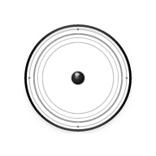
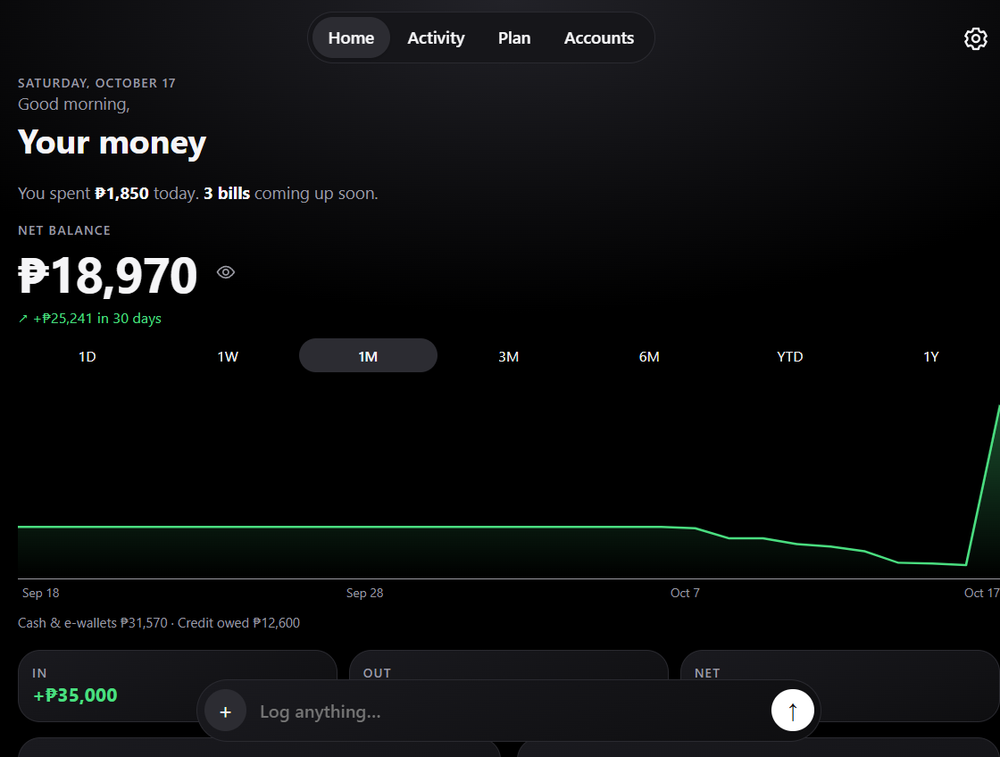
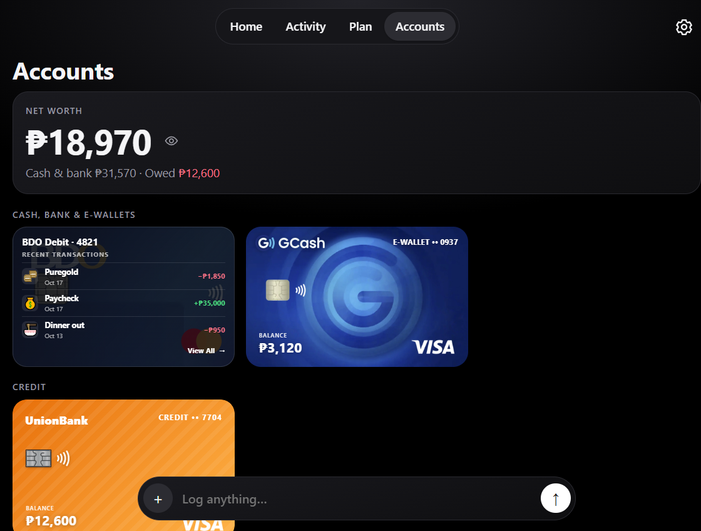

<div align="center">



# Cap — Finance Tracker

### Less money fog. More peace of mind.

**A calm, private-first place to track what comes in, what goes out, and what’s next.**


</div>

---

Cap brings your everyday finances into one clear view. Track accounts and spending, set budgets, and see upcoming bills—without turning money management into another chore.

## A quick look

<p align="center"></p>

<p align="center"><sub>Cap dashboard · shown with the app’s sample data.</sub></p>

## Your money, in one place

| Keep an eye on | Make it yours |
| --- | --- |
| Bank accounts, e-wallets, debit and credit cards | Light, dark, or automatic appearance |
| Income, spending, and recent transactions | Currency and number display preferences |
| Category budgets and spending trends | Categories you can archive and restore |
| Bills, subscriptions, and free-trial end dates | One global control to hide account balances |
| Account-specific activity and card statements | Backup, export, and restore tools |

### A closer look at account activity

Long-press an account card to flip it and see recent transactions for that account. Tap the card to turn it back; choose **View All** to open the full account activity.

<p align="center"></p>

<p align="center"><sub>Account cards · shown with the app’s sample data.</sub></p>

## Private by design

In a regular browser, Cap saves financial data on your device and does not require an account. Optional cloud sync is available only in compatible host environments; without one, Cap remains local-only.

Cap is a lightweight **Progressive Web App (PWA)**. Install it on a supported device for an app-like experience. After an online visit, its cached app shell can load offline.

## Run it locally

Cap is a static app—no framework, package installation, or build step needed. Serve the repository over HTTP so the service worker can run:

```bash
npx --yes serve . -l 8000
```

Open [http://localhost:8000](http://localhost:8000). Service workers require HTTP(S), so `file://` won’t work for offline testing.

## Under the hood

Plain **HTML, CSS, and JavaScript**, using browser storage and Progressive Web App APIs.

---

<p align="center"><sub>Cap is a personal tracking tool, not financial, tax, or investment advice.</sub></p>
